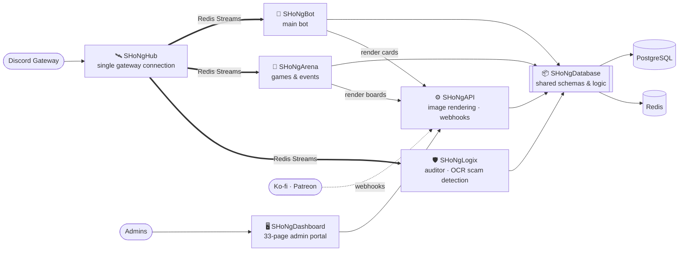
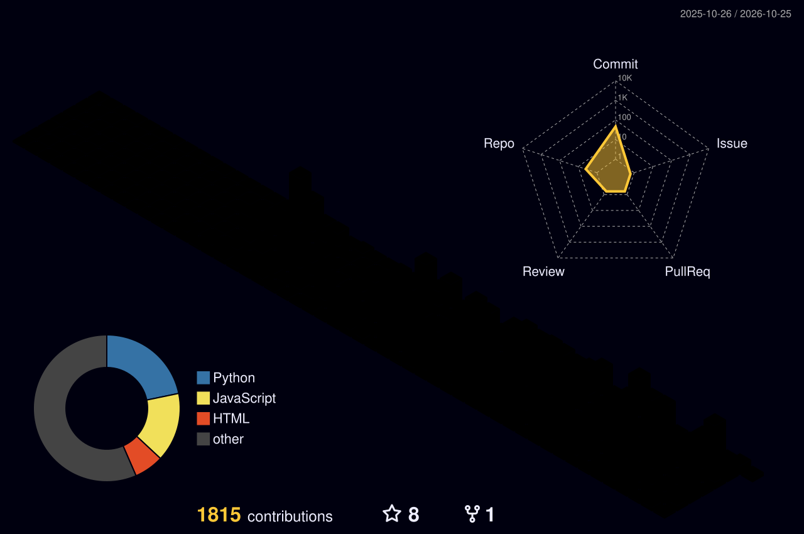

<!-- ═══════════════════════════════════════════════════════════════
     ShkourBashtawi — GitHub Profile README (Full / Advanced)
     ═══════════════════════════════════════════════════════════════ -->

<div align="center">

<!-- Header Banner -->


<!-- Typing Animation -->
<a href="https://git.io/typing-svg">
  
</a>

<br/><br/>

<!-- Badges -->


</div>

---

## 🧬 `whoami`

```ts
const shkour: Engineer = {
  location:   "Jordan 🇯🇴",
  role:       "Fullstack Engineer",
  focus:      ["Discord bots at scale", "Backend & APIs", "Real-time voice & AI apps", "RGB hardware plugins"],
  community:  "Building & running a 200K+ member Discord community",
  stack: {
    backend:  ["Node.js", "NestJS", "Fastify", "Express", "GraphQL", "Python"],
    frontend: ["React", "Next.js", "TypeScript", "Tailwind", "Framer Motion"],
    data:     ["PostgreSQL", "MongoDB", "Redis", "Supabase", "Prisma"],
    infra:    ["Docker", "NGINX", "Linux", "Hetzner", "PM2", "GitHub Actions", "GCP"],
  },
  currentlyLearning: "Rust — moving the hot paths closer to the metal",
  philosophy: "Ship it, measure it, make it faster.",
};
```

---

## ⚡ What I Build

<table>
<tr>
<td width="50%" valign="top">

### 🤖 Discord Bots at Scale
- Sharded **discord.js** bots serving large guilds
- Slash commands, modals, buttons, select menus
- Interactive puzzles / easter-egg systems with role rewards
- Premium tiers & webhook-driven role sync
- Redis-backed cooldowns, caching & rate-limiting

</td>
<td width="50%" valign="top">

### 🧱 Backends & APIs
- **NestJS / Fastify** services with clean module boundaries
- REST + **GraphQL** APIs, typed end-to-end with **Prisma**
- Queues, background jobs & event-driven flows
- Payment & subscription webhooks
- Observability with **Sentry**

</td>
</tr>
<tr>
<td width="50%" valign="top">

### 🎨 Image Engines
- Dynamic rank cards, banners & welcome images
- **@napi-rs/canvas** + **Sharp** pipelines
- Caching rendered assets to keep latency low
- Exploring **Rust** for heavy rendering work

</td>
<td width="50%" valign="top">

### 🚀 Infra & DevOps
- **Docker** + **NGINX** on **Hetzner** VPS fleets
- **PM2** process management & zero-downtime reloads
- CI/CD with **GitHub Actions**
- **ngrok** for webhook dev, **GCP** where it fits

</td>
</tr>
</table>

---

## 🛠️ Tech Stack

<div align="center">

<table>
<tr><td align="center"><b>Backend</b></td><td></td></tr>
<tr><td align="center"><b>Frontend</b></td><td></td></tr>
<tr><td align="center"><b>Data</b></td><td></td></tr>
<tr><td align="center"><b>Bots & Systems</b></td><td></td></tr>
<tr><td align="center"><b>DevOps</b></td><td></td></tr>
<tr><td align="center"><b>Tooling</b></td><td></td></tr>
</table>


</div>

---

## 🐉 SHoNgxBoNg: The Ecosystem I Lead

<div align="center">
<a href="https://github.com/1SHoNgxBoNg"></a>

**[SHoNgxBoNg](https://github.com/1SHoNgxBoNg)**: a seven-service Discord platform powering one community · building since 2022/10

</div>



<table>
<tr>
<th align="left">Service</th><th align="left">What it does</th><th align="left">Highlights</th>
</tr>
<tr><td>🛰️ <b>SHoNgHub</b></td><td>Gateway relay</td><td>Holds the one privileged-intent connection and fans events out over <b>Redis Streams</b></td></tr>
<tr><td>🤖 <b>SHoNgBot</b></td><td>Main community bot</td><td>Temp voice, tickets, clans, staff tools, economy, subscriptions, scheduled jobs</td></tr>
<tr><td>🎲 <b>SHoNgArena</b></td><td>Games & events bot</td><td><b>37 games</b>, profiles, leaderboards, wallet/transfer <b>risk engine</b></td></tr>
<tr><td>🛡️ <b>SHoNgLogix</b></td><td>Event auditor</td><td>Gateway logs to channels + Postgres, <b>OCR scam detection</b> on images</td></tr>
<tr><td>⚙️ <b>SHoNgAPI</b></td><td>Backend service</td><td>Renders cards, boards & charts as images, Ko-fi / Patreon webhooks</td></tr>
<tr><td>🖥️ <b>SHoNgDashboard</b></td><td>Admin portal</td><td><b>33 pages</b>, JWT + OTP login, role-based access control</td></tr>
<tr><td>📦 <b>SHoNgDatabase</b></td><td>Shared library</td><td>Schemas, models, economy config, subscription tiers, game-stats logic</td></tr>
</table>

<sub>🔒 Core services are private. The architecture is public.</sub>

---

## 📌 Featured Projects

<table>
<tr>
<td width="50%" valign="top">

### 🎮 [GameTalk Translator](https://github.com/ShkourBashtawi/GameTalk-Translator)
Hold a hotkey, speak **Arabic**, and an in-game overlay shows the **English** translation, while teammates' English speech becomes Arabic subtitles.

`Python` `QML` `Whisper (offline)` `Azure / Google STT` `Overlay`

</td>
<td width="50%" valign="top">

### 🌈 [SignalRGB · HydroShift II TL Wireless](https://github.com/ShkourBashtawi/SignalRGB-HydroShift-II-TL-Wireless)
Community SignalRGB plugin for the Lian Li HydroShift II + UNI FAN TL Wireless: live lighting over the L-Wireless dongle, fan/pump curves and CPU/GPU stats on the pump LCD.

`JavaScript` `USB HID` `PowerShell` `Reverse-engineering`

</td>
</tr>
<tr>
<td width="50%" valign="top">

### 💡 [SignalRGB · Thermalright TL-M12QR x3 Kit](https://github.com/ShkourBashtawi/SignalRGB-Thermalright-TL-M12QR-x3-Kit)
SignalRGB plugin for the Thermalright TL-M12QR triple-fan kit, so the fans join the rest of the rig's lighting in SignalRGB.

`JavaScript` `SignalRGB` `RGB`

</td>
<td width="50%" valign="top">

### 🪪 [discord-age](https://github.com/ShkourBashtawi/discord-age)
Arabic step-by-step guide to updating the age on a Discord account through Discord Support, with ready-to-copy templates.

`Guide` `Arabic` `Discord`

</td>
</tr>
</table>

<details>
<summary><b>🗄️ Archive & earlier work</b> <sub>(click to expand)</sub></summary>
<br/>

| Project | Year | Notes |
|---|---|---|
| 🧩 [SHoNgPuzzle](https://github.com/1SHoNgxBoNg/SHoNgPuzzle) | 2026 | Riddle → modal → role-reward easter-egg system *(archived)* |
| 🤖 SHoNgBot (v1) | 2022–2026 | First generation of the main bot, since rebuilt as the current ecosystem *(archived, private)* |
| 🛠️ [AdminJS](https://github.com/DevXor-Team/AdminJS) | 2023 | Built with **DevXor Team** |
| 🔊 [discord-tts-bot](https://github.com/ahmadshkour71-projects/discord-tts-bot) | 2023 | Text-to-speech Discord bot |

</details>

<div align="center">
<a href="https://github.com/ShkourBashtawi?tab=repositories"></a>
</div>

---

## 📊 GitHub Analytics

<div align="center">

<!-- Stats + Languages (auto light/dark) -->
<picture>
  <source media="(prefers-color-scheme: dark)" srcset="https://github-readme-stats.vercel.app/api?username=ShkourBashtawi&show_icons=true&theme=tokyonight&hide_border=true&bg_color=0d1117&title_color=58A6FF&icon_color=58A6FF&text_color=c9d1d9&rank_icon=github&include_all_commits=true&count_private=true" />
  
</picture>
<picture>
  <source media="(prefers-color-scheme: dark)" srcset="https://github-readme-stats.vercel.app/api/top-langs/?username=ShkourBashtawi&layout=compact&theme=tokyonight&hide_border=true&bg_color=0d1117&title_color=58A6FF&text_color=c9d1d9&langs_count=8" />
  
</picture>

<br/><br/>

<!-- Streak -->
<picture>
  <source media="(prefers-color-scheme: dark)" srcset="https://streak-stats.demolab.com?user=ShkourBashtawi&theme=tokyonight-duo&hide_border=true&background=0d1117&stroke=58A6FF&ring=58A6FF&fire=FF6B6B&currStreakLabel=58A6FF" />
  
</picture>

<br/><br/>

<!-- Activity Graph -->


<br/><br/>

<!-- Trophies -->


</div>

<details>
<summary><b>🧊 3D Contribution Skyline</b> <sub>(click to expand)</sub></summary>
<br/>
<div align="center">
  <!-- Generated by .github/workflows/profile-3d.yml -->
  
</div>
</details>

<div align="center">
<br/>
<!-- Generated by .github/workflows/snake.yml -->
<picture>
  <source media="(prefers-color-scheme: dark)" srcset="https://raw.githubusercontent.com/ShkourBashtawi/ShkourBashtawi/output/github-snake-dark.svg" />
  
</picture>
</div>

---

## 🔭 Right Now

<table>
<tr>
<td>🐉</td><td><b>Building</b></td><td>The SHoNgxBoNg ecosystem: Hub, Bot, Arena, Logix, API, Dashboard</td>
</tr>
<tr>
<td>🦀</td><td><b>Learning</b></td><td>Rust for high-performance image & data processing</td>
</tr>
<tr>
<td>🎙️</td><td><b>Shipping</b></td><td>GameTalk Translator: real-time Arabic ⇄ English voice translation for gamers</td>
</tr>
<tr>
<td>🌈</td><td><b>Hacking on</b></td><td>SignalRGB plugins for wireless Lian Li & Thermalright hardware</td>
</tr>
<tr>
<td>⚙️</td><td><b>Exploring</b></td><td>AI-assisted dev workflows & agentic tooling</td>
</tr>
<tr>
<td>💬</td><td><b>Ask me about</b></td><td>discord.js at scale, NestJS architecture, Redis patterns, self-hosting</td>
</tr>
</table>

---

## 🎮 Live Discord Status

<div align="center">

<a href="https://discord.com/users/685868171755913293">
  
</a>

<sub>Powered by <a href="https://github.com/Phineas/lanyard">Lanyard</a></sub>

</div>

---

## 🏢 Organizations

<div align="center">

<a href="https://github.com/1SHoNgxBoNg"></a>&nbsp;
<a href="https://github.com/DevXor-Team"></a>&nbsp;
<a href="https://github.com/ahmadshkour71-projects"></a>

</div>

---

## 📬 Let's Connect

<div align="center">

<a href="https://discord.com/users/685868171755913293"></a>
<a href="https://github.com/ShkourBashtawi"></a>

<br/><br/>

<i>"Ship it, measure it, make it faster."</i>

</div>

<!-- Footer Wave -->

